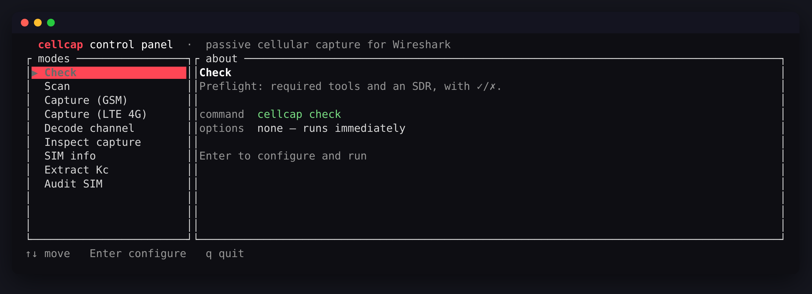
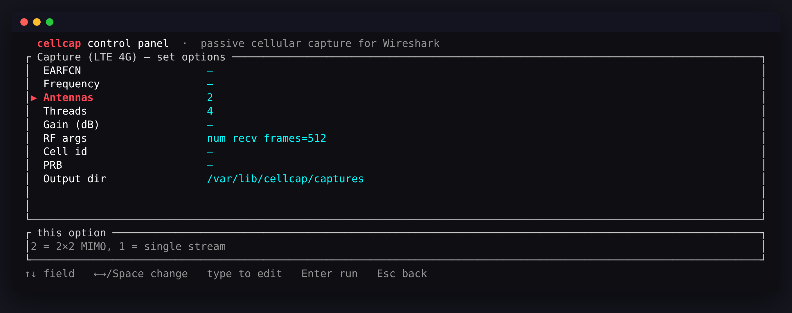
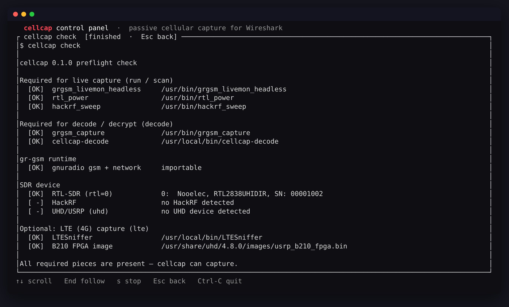
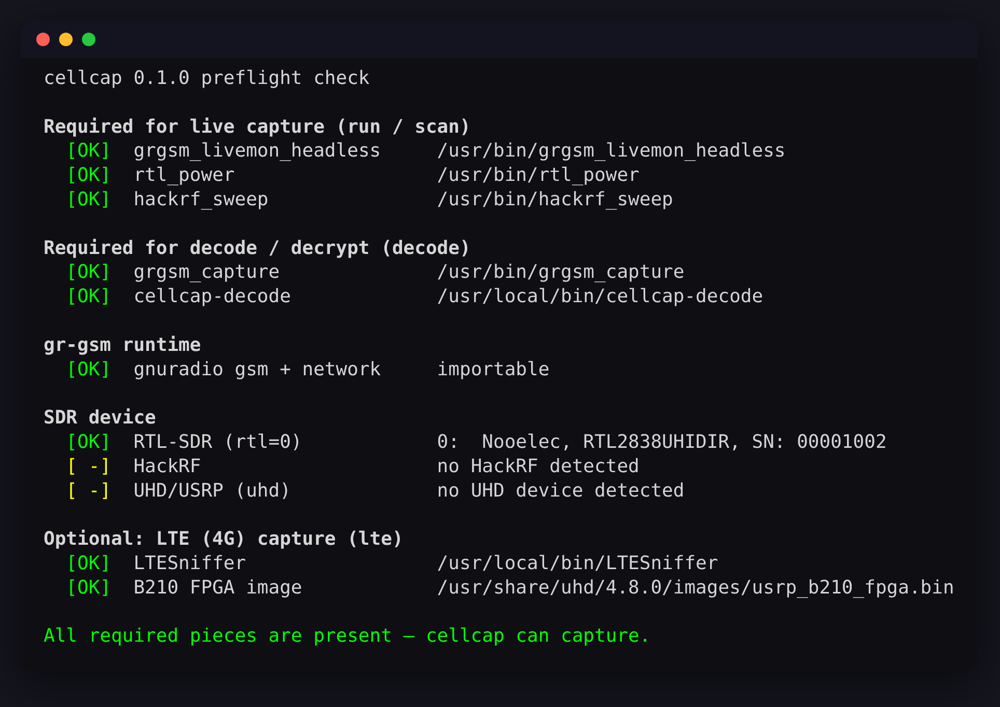
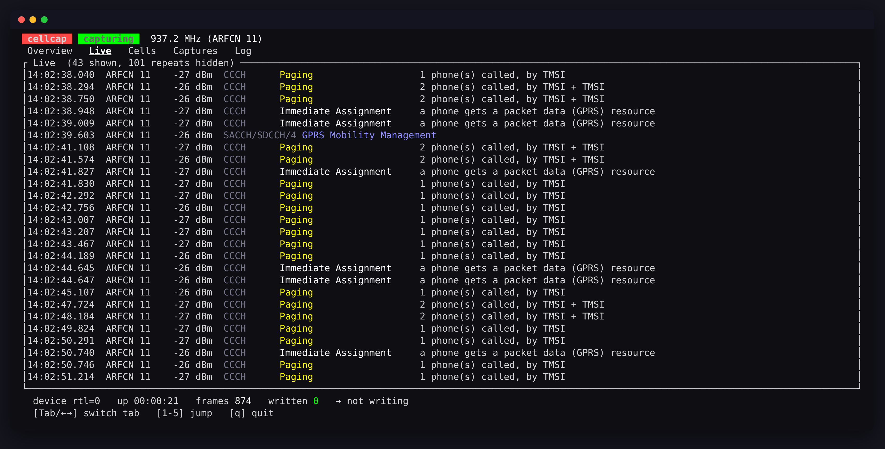

# cellcap

Passive cellular capture for Wireshark. cellcap listens to the broadcast and control
channels of cellular networks with a software-defined radio and writes what it decodes to
pcapng files you open in Wireshark. **It only ever listens — it never transmits.**

- **GSM (2G)** — end to end: scan, capture, decode, optional A5 decrypt, SIM tools.
- **LTE (4G)** — downlink control plane to a MAC-LTE pcap (`cellcap lte`, drives LTESniffer).
- **5G / 3G** — honest scope; see [Beyond GSM](#beyond-gsm-lte--3g--5g).

Everything is driven from one place: run `cellcap` with no arguments for an interactive
**control panel**, or call any mode directly from the command line for scripts and the service.

<p align="center"></p>

---

## The control panel

Run **`cellcap`** with no arguments (or `cellcap ui`) to open the control panel. Pick a mode,
set its options in a form, and run it — watching the output live, all without leaving the UI.
Under the hood the panel just runs the same `cellcap` subcommands, so anything here is equally
available on the command line.

| | |
| --- | --- |
| **Home** — pick a mode | **Configure** — set options |
|  |  |
| **Run** — live output, scrollable | |
|  | |

Keys: `↑`/`↓` move · `Enter` configure/run · `←`/`→`/`Space` change an option · type to edit a
text field · `Esc` back · `s` stop a running capture · `q` / `Ctrl-C` quit.

## What it does

- **Scans** a band: a power sweep (RTL-SDR/HackRF) or `grgsm_scanner` (UHD) finds the channels
  that carry a cell, then each is decoded briefly and only real cells are reported.
- **Captures** broadcast/control channels, chosen by `--freq`, `--arfcn`, PLMN, or the scan.
- **Writes pcapng** itself, with rotation by time and size and a cap on the directory size.
- **Supervises the radio**: the decoder is restarted when it exits or goes quiet.
- **Shows a live dashboard** (`run -i`): the message feed, cells seen, capture files and a log.
- **Decodes dedicated channels** (`decode`): SDCCH/TCH, with optional A5 decryption given the key.
- **Captures LTE** (`lte`): the 4G downlink into a MAC-LTE pcap for Wireshark.
- **Reads the SIM** (`extract-kc`, `sim-info`, `audit-sim`) over a serial modem or PC/SC.
- **Reads a capture back** (`inspect`) and **checks the host** (`check`) — no SDR needed.

The GSM demodulation is done by [gr-gsm](https://github.com/ptrkrysik/gr-gsm) and LTE by
[LTESniffer](https://github.com/SysSec-KAIST/LTESniffer); cellcap is everything around them.

## Commands

| Command | What it does |
| --- | --- |
| `cellcap` / `cellcap ui` | Open the interactive control panel. |
| `cellcap check` | Preflight checklist: required tools and an SDR, with ✓/✗ per item. |
| `cellcap scan` | Find GSM cells and print a table. |
| `cellcap run` | Capture GSM broadcast/control channels to pcapng (the service runs this). |
| `cellcap lte` | Capture the LTE (4G) downlink to a Wireshark MAC-LTE pcap. |
| `cellcap decode` | Decode a dedicated/ciphered channel (SDCCH, TCH) from the SDR or a recording. |
| `cellcap inspect FILE…` | Summarise a capture file, like `tshark -z`. |
| `cellcap extract-kc [DEVICE]` | Read the SIM's session key Kc from a serial modem. |
| `cellcap sim-info [DEVICE]` | Read IMSI, Kc, GPRS Kc and TMSI/LAI from the SIM. |
| `cellcap audit-sim [DEVICE]` | Report the SIM's toolkit/OTA attack surface (Simjacker/WIB class). |
| `cellcap disclaimer` | Print the legal/ethical disclaimer (also `cellcap --disclaimer`). |

## Quickstart

```bash
make release && sudo make install        # build + install binary, service, cellcap user
cellcap check                            # confirm tools + SDR are present
cellcap                                  # open the control panel, or:
cellcap scan                             # what cells are around?
cellcap run --arfcn 11 --output-dir .    # capture one channel until Ctrl-C
wireshark cellcap-gsm-*.pcapng           # open the result
```

## Requirements

- An SDR that gr-osmosdr supports: RTL-SDR (tested, Nooelec v5), HackRF, or a UHD/USRP such as
  a B210 or B210 clone.
- `gr-gsm` (`grgsm_livemon_headless`; plus `grgsm_capture`/`grgsm_decode` for `decode`).
- For scanning on RTL/HackRF: `rtl_power` (`rtl-sdr`) or `hackrf_sweep` (`hackrf`). UHD devices
  are scanned with `grgsm_scanner` instead.
- For `lte`: a B210-class SDR, UHD, and the LTESniffer binary (see [LTE](#capture-lte-cellcap-lte)).
- For the SIM tools: a serial GSM modem with the SIM (e.g. `/dev/ttyUSB0`).
- Rust 1.80+ to build.

Debian: `apt install gr-gsm rtl-sdr hackrf uhd-host`. Then run **`cellcap check`**:

<p align="center"></p>

> **Note on `decode`.** The `grgsm_decode` shipped with gr-gsm calls a GNU Radio block
> (`pdu.socket_pdu`) that current GNU Radio moved to `network.socket_pdu`, so the stock tool
> crashes. `make install` (or `make decoder`) generates a fixed copy, `cellcap-decode`, with
> `tools/gen-decoder.py`. It is a derivative of grgsm_decode (GPLv3), built on your host and not
> shipped in this repository.

## Build and install

```bash
make release
sudo make install     # binary, service, the 'cellcap' user, /etc/default/cellcap
sudo systemctl enable --now cellcap
```

---

## Guides

### Find cells — `cellcap scan`

```bash
cellcap scan                                    # GSM900 on rtl=0
cellcap scan --band GSM900 --band DCS1800       # several bands
cellcap scan --device hackrf=0
cellcap scan --device uhd                        # uses grgsm_scanner
```

```
ARFCN  FREQUENCY    POWER   MCC  MNC  LAC    CID    NETWORK
11     937.2 MHz      3.2   238  01   431    1660   TDC A/S
94     953.8 MHz    -10.1   -    -    -      -      (not GSM)
```

The **NETWORK** column is resolved from the broadcast MCC/MNC through an E.212 lookup (operator,
else country); `(not GSM)` means the channel carries power but no decodable broadcast channel.
The name is data, not logic — it lives in one table (`src/e212.rs`) and the raw codes are always
shown too, so a rebrand or MNC reassignment is a one-line edit.

### Capture GSM — `cellcap run`

```bash
# One channel into the current directory until Ctrl-C
cellcap run --freq 937.2M --output-dir .
cellcap run --arfcn 11 --output-dir .

# Scan, then capture the strongest cell of one network
cellcap run --plmn 23801 --output-dir .

# Live dashboard while capturing (optionally without saving)
cellcap run --arfcn 11 --interactive
cellcap run --arfcn 11 --interactive --no-write
```

**Dashboard (`-i`)** — tabs: *Overview* (channel, phase, counters, cells, dir size), *Live*
(the rolling decoded feed), *Cells* (ARFCN, **operator**, MCC/MNC/LAC/CID, signal, frames),
*Captures* (files on disk), *Log*. Move with `Tab`/`←`/`→` or `1`–`5`, quit with `q`. Subscriber
identities are named by **kind only** (TMSI/IMSI), never by value.

The *Live* feed shows the time, **channel** (BCCH/CCCH/SDCCH/SACCH…), signal, the **decoded event**
(colour-coded), and its detail — so you can watch activity and confirm it matches Wireshark:

<p align="center"></p>

**Line view (`--stream`)** — one readable line per message, for logs or headless terminals.
Each line shows the time, channel, signal, the **decoded event**, and its detail; the operator is
named from the MCC/MNC and dedicated-channel signalling is parsed into events (Location Updating,
Authentication, Ciphering, SMS, call setup, …):

```
14:43:35.378  ARFCN 11  -27 dBm  BCCH     System Information 3     TDC A/S · Denmark · 238/01 · LAC 431 CID 1660
14:43:36.103  ARFCN 11  -27 dBm  CCCH     Immediate Assignment     a phone is sent to SDCCH/8 on timeslot 3
14:43:36.367  ARFCN 11  -27 dBm  CCCH     Paging                   1 phone(s) called, by TMSI
14:43:37.002  ARFCN 11  -26 dBm  SDCCH/8  Authentication Request
14:43:37.511  ARFCN 11  -26 dBm  SDCCH/8  Ciphering Mode Command
```

What's parsed here is only to **confirm the flow matches Wireshark** — the pcap/UDP stream is still
the thing you analyse. Events are best-effort; Wireshark is authoritative.

Main options: `--freq`/`--arfcn` (channel; without either, cellcap scans), `--band`, `--cells`,
`--plmn`, `--dwell`, `--device` (`rtl=0`/`hackrf=0`/`uhd`), `--gain`, `--ppm`, `--output-dir`,
`--rotate-minutes`/`--rotate-mb`, `--max-total-mb`, `--drop-paging`, `-i`/`--stream`/`--no-write`,
`--gsmtap-udp`. One SDR receives one channel at a time, so several channels are captured in turn.

### Live remote Wireshark — `--gsmtap-udp`

Instead of (or as well as) writing pcapng, cellcap can **mirror every GSMTAP frame to a remote
UDP address**, so you watch the capture live in Wireshark on another machine — handy when the SDR
host (e.g. a DMZ box) has no GUI.

```bash
# Mirror to a remote Wireshark, without saving files locally:
cellcap run --arfcn 11 --no-write --gsmtap-udp 172.22.22.20:5555

# Or capture to disk AND mirror at the same time:
cellcap run --arfcn 11 --gsmtap-udp 172.22.22.20:4729
```

cellcap sends the **raw GSMTAP datagrams**; set up the receiving Wireshark one of two ways:

- **udpdump listener (port 5555).** On the Wireshark host, start the **`udpdump`** capture
  interface (Capture → Options → *udpdump* → the **⚙ gear**) and set its **Payload type to
  `gsmtap`**, then `--gsmtap-udp <host>:5555`.

  > **This is the one thing everyone trips on.** udpdump defaults its payload type to `data` and
  > stamps that name into the exported-PDU `DISSECTOR_NAME` tag, so Wireshark shows the frames
  > **undissected** until you change it to `gsmtap`. There is no pass-through mode — the payload
  > type is the only lever. (`tshark -i udpdump -o extcap.udpdump.payload:gsmtap`.)
- **Direct on port 4729.** Capture on the normal network interface and filter `udp.port == 4729`;
  Wireshark auto-dissects GSMTAP on its registered port. Then `--gsmtap-udp <host>:4729`.

`--gsmtap-udp` works alongside `-i` (watch the local dashboard while mirroring) or `--stream`,
and respects `--drop-paging` (dropped frames are not mirrored). Remember the frames cross the
network in the clear — only mirror to a host and network you control, and see the **Disclaimer**.

### Capture LTE — `cellcap lte`

Drives **LTESniffer** to demodulate the LTE **downlink** control plane (PDCCH/DCI, and PDSCH
where unciphered) into a **MAC-LTE pcap** Wireshark reads directly.

```bash
# Cell search finds PCI/PRB, then captures the downlink:
sudo cellcap lte --earfcn 1575          # band 3, 1842.5 MHz — or --freq 1842.5M
sudo cellcap lte --freq 806M            # band 20

# Lock to a known cell (skip the search):
sudo cellcap lte --freq 806M --cell-id 379 --prb 100
```

Writes `lte_dl_<time>.pcapng.pcap` into the capture directory; open it in Wireshark and filter
on `mac-lte`. `--earfcn` understands the common FDD bands (1–66); otherwise give `--freq`. The
B210 has two RX, so `--antennas 2` (default) decodes 2×2 MIMO (TM3/4); `--antennas 1` is single
stream (TM1). LTESniffer needs the SDR and real-time priority, so **run it as root**. Downlink
only — uplink needs two time-synced SDRs and is out of scope.

LTESniffer is third-party GPL tooling kept out of this repo; build it with
`tools/build-ltesniffer.sh` (or the readiness notes shipped alongside it), then install it to
`/usr/local/bin` or point `CELLCAP_LTESNIFFER` at it. `cellcap check` reports whether it and the
B210 FPGA image are present.

### Decode dedicated / ciphered channels — `cellcap decode`

`run` captures broadcast/common channels. To decode a **dedicated** channel — SDCCH signalling
(Location Updating, authentication, SMS) or a traffic channel — use `decode`. It records a short
cfile (or takes one you give) and runs the decoder over it into a pcapng.

```bash
# SDCCH/8 on timeslot 1, recording 20 s from the SDR
cellcap decode --arfcn 11 --mode sdcch8 --timeslot 1

# Combined-C0 control channel (SDCCH/4) from an existing recording
cellcap decode --arfcn 11 --mode bcch-sdcch4 --timeslot 0 --cfile grab.cfile

# A ciphered channel, with the A5 session key
cellcap decode --arfcn 11 --mode sdcch8 --timeslot 1 --cipher-a5 1 --cipher-kc 1234567890ABCDEF
```

Modes: `bcch`, `bcch-sdcch4`, `sdcch8`, `tchf`, `tchh`. Decryption happens inside the decoder
(Wireshark cannot do A5). Supply the **session key Kc** with `--cipher-kc`; the SIM master key
**Ki cannot be used directly** — derive Kc from Ki and the RAND first.

> This gr-gsm has **no GPRS/PDTCH decoder**, and none of these tools follow a **frequency-hopping**
> traffic channel; `decode` works on one fixed channel at a time.

### Keys, identities and audit from the SIM

With the test SIM in a serial GSM modem:

```bash
cellcap extract-kc /dev/ttyUSB0      # the A5 session key Kc (+ CKSN)
cellcap sim-info   /dev/ttyUSB0      # IMSI, Kc, GPRS Kc, and TMSI + LAI
cellcap audit-sim  /dev/ttyUSB0      # toolkit/OTA attack surface
```

Use the **IMSI** (or **TMSI**) in Wireshark to filter a capture to your own phone
(`gsm_a.imsi == "<imsi>"`). Pass the **Kc** to `cellcap decode --cipher-kc`. `audit-sim` reads
the SIM Service Table (EF_SST) and flags toolkit/OTA features behind known attacks — above all
**Data download via SMS-PP**, the precondition for Simjacker and WIBattack — then maps a
catalogue of UICC attacks (preconditions met?) and device/OS attacks (not determinable from the
card). These are capability flags, not proof of vulnerability. SIM values are secrets — keep them
off shared machines and out of capture files you circulate.

> The modem may be held by another program (e.g. an SMS gateway) or `ModemManager`; stop it first.

### Read a capture back — `cellcap inspect`

```bash
cellcap inspect cellcap-gsm-20261127T085130Z.pcapng
```

Prints frame counts by message type and channel, the cells seen and the time span — a quick way
to confirm a file holds what you want before opening Wireshark. No SDR needed.

### UHD / USRP (and B210 clones)

A USRP (or UHD-compatible B210 clone) works like any other device — pass `--device uhd`:

```bash
cellcap scan --device uhd            # grgsm_scanner (UHD has no power-sweep tool)
cellcap run  --device uhd --arfcn 11
```

`run --freq`/`--arfcn` and `decode` pass `--device` straight to gr-gsm, so they work on any
gr-osmosdr device. A B210's wider bandwidth also makes it the base for LTE capture.

---

## Beyond GSM (LTE / 3G / 5G)

cellcap's own decoder is **GSM (2G)**. For other radio technologies it orchestrates dedicated
tools where that is realistic, and is honest where passive capture isn't:

- **LTE (4G): supported** via `cellcap lte` → LTESniffer → MAC-LTE pcap (see above). Downlink,
  single B210-class SDR.
- **UMTS (3G): not supported — no passive path.** There is no open-source passive WCDMA downlink
  sniffer, and LTE tools don't transfer (WCDMA is a different, CDMA air interface). A B210 can
  survey/record 3G spectrum, but not decode the control plane. cellcap does not pretend otherwise.
- **5G NR: research-grade, file-first.** [5GSniffer](https://github.com/spritelab/5GSniffer)
  (Sprite Lab) is a 5G PDCCH blind decoder (DCI / active RNTIs) on srsRAN; it works best from a
  recorded I/Q file and live B210 capture is limited to narrow (~10 MHz) FDD carriers. Not wired
  into cellcap — run it directly against a recording.

## The service

Settings live in `/etc/default/cellcap` as the arguments of `cellcap run`. After a change:
`sudo systemctl restart cellcap`. Logs: `journalctl -u cellcap -f`. The service runs as the
unprivileged user `cellcap` (in group `plugdev` for SDR access).

## Getting the captures into Wireshark

GSM files are `cellcap-gsm-<UTC time>.pcapng` in `/var/lib/cellcap/captures`; the newest is
flushed every two seconds, so a copy taken any time opens fine.

```bash
scp 'root@host:/var/lib/cellcap/captures/*.pcapng' .
wireshark cellcap-gsm-*.pcapng
```

Useful display filters:

| Filter | Shows |
| --- | --- |
| `gsm_a.dtap.msg_rr_type == 0x1b` | System Information 3: network/area/cell identity |
| `gsm_a.dtap.msg_rr_type == 0x21` | Paging requests |
| `gsm_a.dtap.msg_rr_type == 0x3f` | Immediate assignments |
| `gsmtap.chan_type == 1` | Broadcast channel only |
| `gsm_a.imsi == "<imsi>"` | Only your own device (from `sim-info`) |
| `gsmtap.arfcn == 11` | One channel |
| `mac-lte` | LTE downlink (from `cellcap lte`) |

Wireshark's **Telephony → GSM** menu summarises the same data.

## What is and is not in a capture

- **In a GSM `run`:** system information, paging, immediate assignments; on a combined-C0 cell the
  SDCCH/4 and SACCH too (Location Updating, authentication, SMS on signalling, in the clear until
  ciphering starts).
- **With `decode` and a key:** ciphered SDCCH/8 and traffic channels.
- **With `lte`:** the LTE downlink control plane (and unciphered user plane).
- **Only the downlink** is received — what base stations send, not what phones send.

## Privacy and law

Paging messages contain the temporary (TMSI) and sometimes permanent (IMSI) identities of other
people's phones. Treat capture files as personal data: keep them private and do not publish them;
`--drop-paging` leaves these messages out. Receiving is passive, but rules on intercepting and
storing radio traffic differ by country — see the **Disclaimer** below.

## Limits

- GSM is fully native; LTE is via LTESniffer; 3G/5G as described above.
- An RTL-SDR with an R820T tuner cannot reach the 1800 MHz band; a HackRF or UHD/B210 can.
- The GSM scan needs `rtl_power`/`hackrf_sweep` (RTL/HackRF) or `grgsm_scanner` (UHD).
- **No GPRS/PDTCH decode**; **frequency-hopping** traffic channels are not dehopped.
- `decode` relies on the generated `cellcap-decode` (the packaged `grgsm_decode` is broken against
  current GNU Radio).
- Deciphering uses the session key Kc (A5), not the SIM master key Ki.

## Disclaimer

**cellcap is a passive receiver — it never transmits — but how you may receive, record, decode,
decrypt and store cellular traffic is regulated, and in many countries doing so without
authorisation is a criminal offence, regardless of whether the content looks sensitive.**

By using cellcap you confirm that:

- You have the authorisation you need to receive and record the traffic in your location — your
  own test network, a lab, or a written engagement with the operator. When in doubt, assume you
  need permission.
- You will only read SIM/UICC cards (`extract-kc`, `sim-info`, `audit-sim`) that you own or are
  explicitly authorised to test, with known test keys.
- A capture can contain **other people's identifiers** (paging TMSI/IMSI) — personal data. Keep
  capture files private, do not publish them, use `--drop-paging` when you don't need them, and
  never decipher other people's traffic without authorisation.
- You, the operator, are solely responsible for complying with the laws that apply to you.
  Decryption (A5 via a known Kc) is for authorised debugging of networks and test SIMs you are
  permitted to work with.

cellcap is provided under the MIT licence, **without warranty of any kind**; the authors accept no
liability for how it is used. Run `cellcap --disclaimer` to print this notice. If you are not sure
whether something is permitted where you are, do not run it until you have checked.

— THUGSred · https://thugs.red
